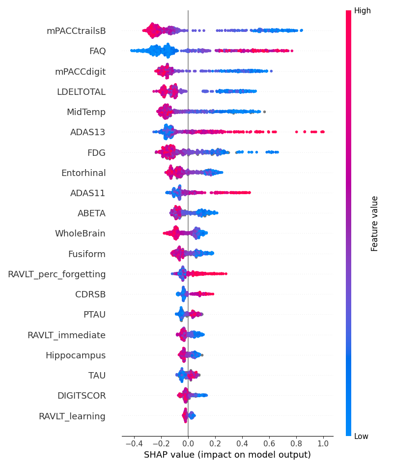
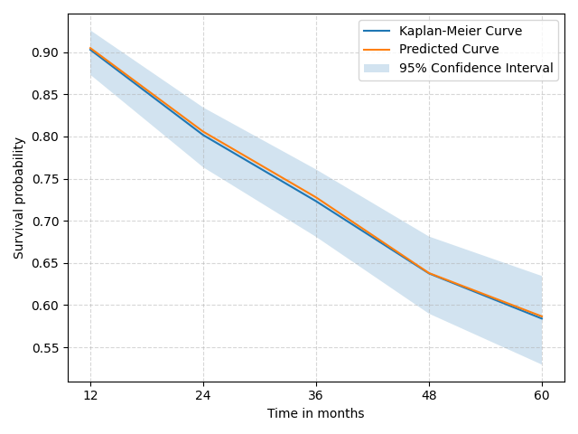

# Predicting MCI-to-Alzheimer's conversion with survival models and SHAP

Code from my bachelor's thesis (Computer Engineering, University of Zaragoza, 2024). The goal was to estimate **when** a patient with mild cognitive impairment (MCI) is likely to progress to Alzheimer's disease (AD) within 5 years, and to understand **why** the model makes each prediction.

I compared two survival models from `scikit-survival`, Random Survival Forests (RSF) and Gradient Boosting Survival Analysis (GBSA), on ADNI data, and used SHAP to explain them.

<p align="center">
  
  
</p>
<p align="center"><sub>Left: features driving the RSF model at baseline (positive SHAP = higher risk of conversion). Right: average predicted survival curve vs the Kaplan-Meier estimate on the test folds.</sub></p>

Full thesis (in Spanish): [Zaguán, University of Zaragoza repository](https://zaguan.unizar.es/record/146602)

## Why survival analysis

Most work on this problem trains a binary classifier: will this patient convert or not? But clinical studies like ADNI are full of **censored** patients, people who leave the study before we know if they converted. A classifier either drops them or treats them as stable, and both options are wrong.

Survival models use those patients as they are ("stable for at least 36 months") and predict a full survival curve per patient instead of a single label.

## Data

Data comes from the [Alzheimer's Disease Neuroimaging Initiative (ADNI)](https://adni.loni.usc.edu/) (`ADNIMERGE` table). **It is not included in this repository**: access has to be requested to ADNI and its data use agreement does not allow redistribution.

I kept patients diagnosed with MCI at baseline with at least 3 yearly visits in the first 5 years, and normalised MRI volumes by intracranial volume (full preprocessing in section 2.1 of the thesis). This gives 336–494 patients depending on the reference visit: baseline, month 12, month 24, or baseline + month 12 as longitudinal data. Features follow the set used by [Sarica et al. (2023)](https://doi.org/10.1186/s40708-023-00211-w): demographics, APOE4, FDG-PET, CSF biomarkers, cognitive tests and MRI volumes.

## Pipeline

1. **Split** into 5 folds.
2. **Impute** missing values with MissForest inside each fold, separately for train and test, so test data never leaks into training.
3. **Train** RSF or GBSA on each fold.
4. **Evaluate** with Harrell's c-index. To compare with classification papers, I also turn the predicted survival probability at month 60 into a label (threshold 0.5) and compute accuracy, sensitivity, specificity and F1.
5. **Explain** with SHAP, aggregating the test predictions of all folds.

## Results

RSF, mean ± std over 5 folds (the full table with GBSA and all metrics is in the thesis):

| Reference visit | c-index | Sensitivity | F1 |
|---|---|---|---|
| Baseline | 0.844 ± 0.031 | 0.738 ± 0.061 | 0.697 ± 0.037 |
| Month 12 | **0.875** ± 0.032 | **0.760** ± 0.070 | 0.682 ± 0.035 |
| Month 24 | 0.872 ± 0.035 | 0.653 ± 0.150 | 0.591 ± 0.058 |
| Baseline + month 12 | 0.869 ± 0.027 | 0.746 ± 0.078 | **0.701** ± 0.036 |

- **RSF was better and more stable than GBSA overall.** Its average survival curve is almost on top of the Kaplan-Meier estimate, while GBSA is too optimistic early on and too pessimistic later.
- **Visits closer to the event help**, up to a point. At month 24 there are fewer patients and only 19% converters, so sensitivity drops and results get noisy, much more for GBSA (0.46) than for RSF.
- **Adding month-12 data to baseline** gives results similar to using month 12 alone.

## What the models learned

The same features keep showing up at the top for both models and across visits:

- **mPACC** (a composite of cognitive tests), the strongest feature in almost every model.
- **FAQ**, a questionnaire about everyday functional activities. The baseline FAQ score is more informative in the longitudinal model than many features measured a year later.
- **LDELTOTAL** (episodic memory) and **FDG** (brain glucose metabolism).
- **MidTemp** (middle temporal gyrus volume) was the only MRI feature important from the start. The hippocampus only gains weight at later visits.

This is consistent with clinical knowledge: predictions come from cognitive, functional, metabolic and structural evidence adding up, not from a single test.

## Limitations

- Hyperparameters were set by hand, not tuned with a search.
- The 0.5 threshold is a choice. Other thresholds improved sensitivity in some cases but made results much less stable between folds.
- The cohort is small and some features have a high share of imputed values.
- Sarica et al. report a higher c-index (0.890) with a different library (`pysurvival`) and extra data sources, so the numbers are not directly comparable.

## How to run it

Imputation and training need **separate environments**, because `missingpy` (MissForest) only works with old versions of scikit-learn, while `scikit-survival` needs a newer one:

| Step | Python | Key packages |
|---|---|---|
| Imputation | 3.8 | missingpy 0.2.0, scikit-learn 1.1.3 |
| Training and SHAP | 3.11.8 | scikit-survival 0.22.2, scikit-learn 1.3.2, shap 0.44.1 |

The full pinned versions are in `imputer_requirements.txt` and `train_requirements.txt`.

Place one CSV per reference visit in `data/`, named `ADNIMERGE_<viscode>.csv` (`bl`, `m12`, `m24` or `bl+m12`), with a `RID` column, the features, `DX` (`MCI` or `Dementia`) and `M` (months until conversion or last visit). Then:

```bash
# Python 3.8: k-fold split + imputation -> data/imputed/<viscode>/
pip install -r imputer_requirements.txt
python imputer.py -v bl -k 5

# Python 3.11: training, metrics and SHAP plots
pip install -r train_requirements.txt
python train_rsf.py -v bl -k 5   # or train_gb.py
```

## Acknowledgements

Supervised by Mónica Hernández Giménez and Elvira Mayordomo Cámara (University of Zaragoza).

Data used in this work was obtained from the Alzheimer's Disease Neuroimaging Initiative (ADNI) database. The ADNI investigators contributed to the design and implementation of ADNI and/or provided data but did not participate in the analysis or writing of this work.
